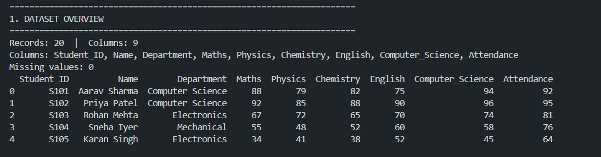
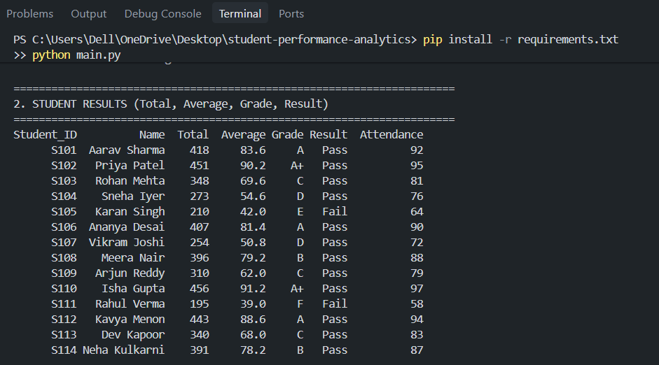
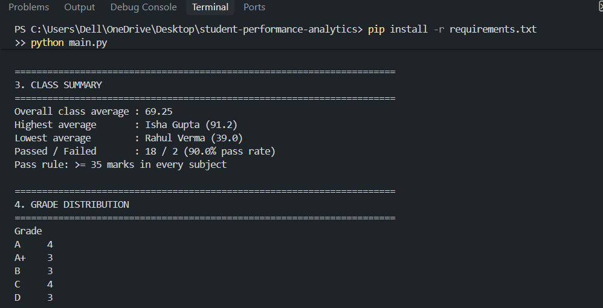
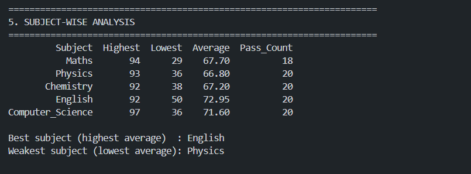
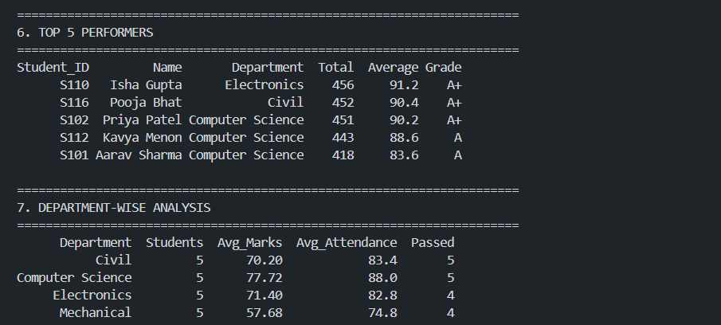
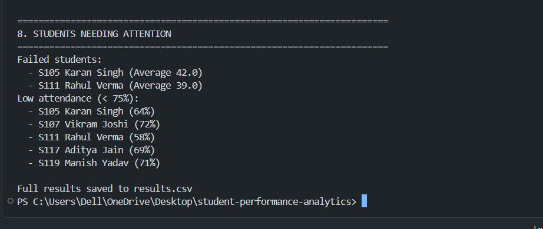

# Student Performance Analytics System

## 1. Project Title
**Student Performance Analytics System** — Python with AI (EWB Courses) project assignment

- **Student:** Tushar Jitendra Bhadane
- **GitHub:** https://github.com/Tushar6405/student-performance-analytics

## 2. Objective
Teachers and institutions hold student marks in raw tables, which makes it hard to see who is performing well, who needs help, and which subjects are weak. This project reads student records and automatically produces totals, averages, grades, pass/fail results, subject-wise statistics and a list of top performers, so that class performance can be understood at a glance.

## 3. Technologies Used
- **Python 3**: variables, data types, loops, conditions, functions
- **NumPy**: row-wise sums/means, boolean checks, `np.where`
- **Pandas**: CSV loading, DataFrames, sorting, group-by aggregation

No other libraries or machine learning were used.

## 4. Dataset Description
`students.csv` contains **20 student records** with 9 columns:

| Column | Description |
|---|---|
| Student_ID | Unique ID (S101–S120) |
| Name | Student name |
| Department | Computer Science, Electronics, Mechanical or Civil (5 students each) |
| Maths, Physics, Chemistry, English, Computer_Science | Marks out of 100 |
| Attendance | Attendance percentage |

The data is realistic sample data created for this project, covering high, average and weak performers.

## 5. Implementation
1. **Load data**: `load_data()` reads the CSV into a Pandas DataFrame; `main.py` prints record count, columns and missing values.
2. **Total & average**: `add_total_and_average()` converts the subject columns to a NumPy array and uses `np.sum` / `np.mean` with `axis=1`.
3. **Grades**: `assign_grade()` applies the grading rule below; `add_grades()` loops over every student's average.
4. **Pass/Fail**: `add_result()` uses `np.all(marks >= 35, axis=1)` with `np.where`.
5. **Subject analysis**: `subject_analysis()` loops through subjects and computes highest, lowest, average and pass count with NumPy.
6. **Top performers**: `top_performers()` sorts by average and returns the top 5.
7. **Department analysis**: `department_analysis()` uses Pandas `groupby`.
8. **Output**: `main.py` prints all sections with headings and saves `results.csv`.

**Grading rule (based on average marks):**

| Average | Grade |
|---|---|
| 90+ | A+ |
| 80–89.99 | A |
| 70–79.99 | B |
| 60–69.99 | C |
| 50–59.99 | D |
| 40–49.99 | E |
| Below 40 | F |

**Pass condition:** a student passes only if they score at least **35 in every subject**. Attendance below **75%** is flagged separately.

## 6. Key Features
- Pandas DataFrame based data handling
- Reusable functions in `functions.py`
- Total, average, grade and pass/fail for every student
- Highest, lowest and overall class average
- Subject-wise analysis (best and weakest subject)
- Top 5 performers
- Department-wise comparison
- Report of failed students and low-attendance students

## 7. Output / Screenshots
Run `python main.py`. Full console output is in [`sample_output.txt`](sample_output.txt). Key results:

- Overall class average: **69.25**
- Highest average: **Isha Gupta (91.2)**
- Lowest average: **Rahul Verma (39.0)**
- Passed / Failed: **18 / 2** (90% pass rate)
- Best subject: **English** (72.95); weakest: **Physics** (66.80)













## 8. Final Outcome
The program runs without errors and turns raw marks into clear results: every student has a total, average, grade and pass/fail status, and the class is summarised by subject and department. Top performers and students needing attention (failed or low attendance) are identified automatically.

## 9. Challenges & Learning
- **Defining a fair pass rule:** a pass based only on the average could hide a failed subject, so I required a minimum in every subject.
- **Row-wise vs column-wise NumPy operations:** I learned to use the `axis` argument (`axis=1` for per-student, columns for per-subject).
- **Combining loops with vectorised code:** loops are used for grading and subject analysis, while NumPy handles bulk calculations.
- **Learning:** organising code into reusable functions makes it easier to test and read.

## 10. GitHub Repository
https://github.com/Tushar6405/student-performance-analytics

## How to Run
```bash
git clone https://github.com/Tushar6405/student-performance-analytics.git
cd student-performance-analytics
pip install -r requirements.txt
python main.py
```

## Project Structure
```
student-performance-analytics/
├── main.py            # runs the analysis and prints the report
├── functions.py       # reusable calculation functions
├── students.csv       # dataset (20 records)
├── sample_output.txt  # sample program output
├── requirements.txt
└── README.md          # project documentation
```
